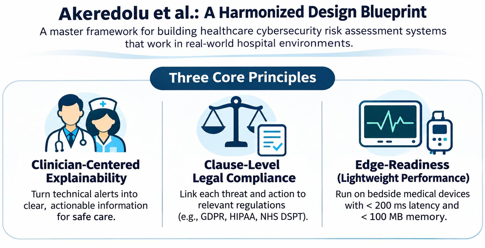
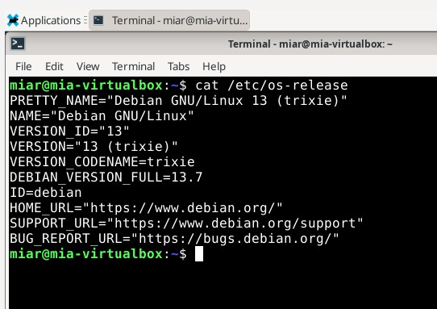
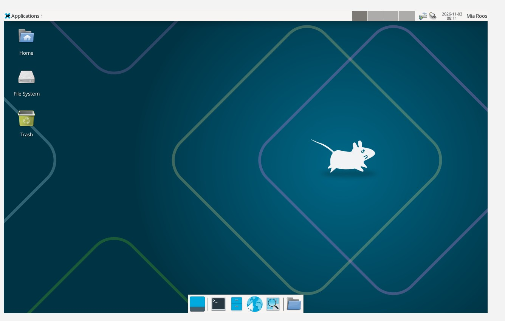

# H2 Scene – Cybersecurity Studies

## H2 a) Podcast – Darknet Diaries, Episode 167: ThreatLocker
One of the most interesting aspects of the episode was the case involving a hospital organization. My understanding was that the attackers were able to move between connected systems because the security measures were insufficient to prevent the attack from spreading.
The episode helped me understand the importance of Zero Trust. The principle does not mean denying all access. Instead, access should be granted according to verified identity, security requirements, and legitimate work-related needs.
Another important concept is least privilege, which means limiting access rights to what is necessary for specific tasks.

### My reflection
From a healthcare perspective, this raises an important question: How can hospitals ensure that healthcare professionals have timely access to essential patient information while preventing attackers from moving between interconnected systems?
The case also demonstrates why cybersecurity must be considered an organisational and patient safety issue, rather than solely a technical responsibility.

### Source
Darknet Diaries. (2025, December 23). Episode 167: ThreatLocker. https://darknetdiaries.com/episode/167/

---

## H2 b) Blog – Krebs on Security

**Article:** Krebs, B. (2026, March 11). *Iran-Backed Hackers Claim Wiper Attack on Medtech Firm Stryker.*

**Source:** https://krebsonsecurity.com/2026/03/iran-backed-hackers-claim-wiper-attack-on-medtech-firm-stryker/

### Summary

The article describes a major cyberattack against Stryker, an international medical technology company supplying essential medical equipment and services to hospitals. The hacker group Handala claimed responsibility for the attack, which significantly disrupted the company's operations.

According to Krebs (2026), the attackers may have misused Microsoft Intune, a legitimate device management tool, to remotely wipe data from connected devices. However, this attack method had not been independently confirmed.

The incident also affected healthcare organisations relying on Stryker's products and services. One healthcare professional reported difficulties ordering surgical supplies, while some hospitals temporarily disconnected from Stryker's LIFENET service, which supports ECG transmission between emergency medical services and hospitals.

### My Reflection

What I found particularly interesting was how a cyberattack against an external technology supplier could affect hospital operations, even when the hospital itself was not directly attacked.

The incident made me think about how dependent modern healthcare is on external technology providers, medical devices, and interconnected digital services.

From a patient safety perspective, this raises an important question:

**How can hospitals maintain continuity of care when a critical external technology provider experiences a cyberattack?**

In my view, healthcare organisations should identify their critical external dependencies, assess supplier-related cybersecurity risks, and prepare alternative procedures to ensure that essential patient care can continue during disruptions.

---

## H2 c) Science That – Connecting Research with a Real-World Cybersecurity Incident

For this task, I selected the systematic review by Akeredolu et al. (2027), which focuses on cyber threat intelligence and cybersecurity risk assessment in healthcare. I connected the research topic with the Stryker cyberattack reported by Krebs (2026), as it provides an interesting case from a healthcare perspective.

Krebs provides a non-scientific, journalistic report on the incident. Stryker is an international company that supplies essential medical devices and equipment to hospitals on a large scale. Krebs (2026) reported that Stryker experienced a major cyberattack that significantly disrupted the company's operations, including its ability to supply medical equipment to hospitals.
It is important to note that some of the information presented in Krebs's report may be unverified, as the article draws on several different sources. Nevertheless, cyberattacks affecting healthcare organizations or their suppliers can pose potential risks to patient safety and continuity of care. This is particularly interesting because a cyberattack can affect healthcare services even when the original attack is not directed at a hospital.

The study by Akeredolu et al. (2027) investigates how Cyber Threat Intelligence (CTI)—information about digital security threats—can be integrated into Cybersecurity Risk Assessment (CSRA) in healthcare to safeguard patient safety and privacy.
According to Akeredolu et al. (2027), there are "implementation gaps" between advanced cybersecurity research and its practical application. 

The authors identify three main gaps:
- The Communication Gap: Healthcare professionals may not understand technical threat alerts (e.g., error codes) or how cyberattacks can affect diagnostic decisions, clinical procedures, and patient safety.
- The Legal Gap: Advanced cybersecurity tools may lack the ability to link their findings to specific healthcare regulations (e.g., GDPR), making it difficult for hospitals to demonstrate regulatory compliance during audits.
- The Hardware Gap: Cybersecurity software developed in research laboratories may be too resource-intensive or slow to operate effectively on medical equipment used at the patient's bedside.
  
Krebs (2026) reported that the American Hospital Association was actively exchanging information with hospitals and federal authorities to understand the nature of the attack and assess its potential impact on hospital operations. However, Krebs (2026) does not explain how this information was communicated to healthcare personnel. Connecting this case with the systematic review by Akeredolu et al. (2027) raises an important question: How can cyber threat intelligence be integrated into healthcare organisations' risk assessment and preparedness processes, particularly when threats affect external technology providers and healthcare personnel may lack the knowledge needed to identify potential security-related problems? Sharing information in an understandable format and communicating effectively are important for improving cybersecurity risk management and developing a resilient organisational culture.

Akeredolu et al. (2027) introduce a conceptual framework, A Harmonized Design Blueprint, as a proposed solution for addressing the identified implementation gaps. 

The framework is based on three core principles:
1.	Clinician-Centered Explainability: Cybersecurity alerts should be understandable to doctors and nurses. Instead of displaying a complicated technical error, the system might provide a message such as: "This infusion pump may be affected by a cyber threat. Check its operation before use."
2.	Clause-Level Legal Compliance: The system should connect cybersecurity threats and defensive actions to relevant legal requirements. For example, if patient data is at risk, the system should identify the relevant GDPR requirements and document the response.
3.	Edge-Readiness: Cybersecurity software must be fast and lightweight enough to operate on medical devices. For example, a heart monitor should remain responsive while the cybersecurity system operates in the background.



*Figure: A Harmonized Design Blueprint, based on Akeredolu et al. (2027). AI-generated illustration.*

### Cyber Threat Intelligence and Information Sharing

The Stryker incident provides a practical example of the importance of cybersecurity-related information sharing in healthcare.
Krebs (2026) reported that the American Hospital Association was actively exchanging information with hospitals and federal authorities to understand the nature of the attack and assess its potential impact on hospital operations. In addition, Maryland emergency medical services authorities communicated information about disruptions affecting Stryker's LIFENET service and provided alternative procedures for ECG communication.

These examples illustrate how information about a cyber incident can support risk assessment and operational decision-making in healthcare. The case also highlights the importance of distinguishing technical threat intelligence from broader operational information sharing during cybersecurity incidents.
The Stryker incident demonstrates why cyber threat intelligence and risk assessment should extend beyond an organization’s own IT infrastructure. Healthcare organizations depend on external technology providers because medical devices and interconnected digital services are essential components of patient care. Simply put, a hospital cannot function without medical equipment.

As reported in the Krebs on Security blog, Microsoft Intune may have been used in the attack. Intune is a cloud-based device management solution designed to help IT teams manage devices, security, and compliance. According to preliminary information reported by Krebs (2026), attackers may have misused Intune's remote wipe functionality to delete data from managed devices. However, this attack method had not been independently confirmed in the article. The possibility that a legitimate security management tool could be misused is particularly interesting. It illustrates why cybersecurity risk assessment should consider not only malicious software but also the potential consequences of compromised administrative privileges and trusted technologies. This also reminds me of the Zero Trust approach, which emphasizes verifying access and limiting permissions to what is necessary. The reported disruption of Stryker's services also raised questions about healthcare continuity. Some hospitals temporarily disconnected from LIFENET, a service supporting ECG transmission between emergency medical services and hospitals.

### My Reflection

Connecting the research topic with this real-world incident helped me recognize that cybersecurity risk assessment in healthcare must extend beyond individual technical vulnerabilities. A key question is how healthcare organizations can use cyber threat intelligence to anticipate threats, assess their dependencies on external providers, and prepare for disruptions that may affect patient care. Furthermore, educating healthcare personnel is essential for developing a cyber-resilient organisational culture in hospitals. In my view, online courses alone are not sufficient to build cybersecurity resilience. Hands-on exercises and practice-based learning are also needed. Cybersecurity incidents should be reported and discussed openly among healthcare professionals to support organisational learning and improve preparedness for future incidents. From a healthcare perspective, the ultimate objective is not only to protect information systems but also to maintain patient safety, continuity of care, and trust across the organisation.


### References

Akeredolu, O., Epiphaniou, G., & Maple, C. (2027). Multimodal cyber threat intelligence fusion for healthcare cybersecurity risk assessment: A systematic review. *Computers & Security, 172*, 105170. https://doi.org/10.1016/j.cose.2026.105170

Krebs, B. (2026, March 11). Iran-Backed Hackers Claim Wiper Attack on Medtech Firm Stryker. Krebs on Security. https://krebsonsecurity.com/2026/03/iran-backed-hackers-claim-wiper-attack-on-medtech-firm-stryker/

---

## H2 d) Download Debian 13 Trixie

### Downloading the Debian Installation Image

For this assignment, I downloaded Debian GNU/Linux 13 (Trixie) from the official Debian website:
https://www.debian.org/

I selected the Live Xfce version for AMD64 architecture, as instructed in the assignment.

The downloaded ISO file was:
debian-live-13.7.0-amd64-xfce.iso

The Live version allows users to try Debian before installing it. Xfce is a lightweight desktop environment suitable for virtual machines.

Result: The Debian 13 Trixie installation image was successfully downloaded to my Windows computer.

---

## H2 e) Install Debian on a Virtual Machine (Voluntary Bonus)

### Installing Oracle VirtualBox

I decided to complete the voluntary bonus assignment by installing Debian in a virtual machine.
I downloaded and installed Oracle VirtualBox 7.2.22 on my Windows computer.
I created a new virtual machine with the following configuration:

| Setting | Configuration |
|---|---|
| Virtual machine name | Debian 13 Trixie |
| Operating system | Debian Linux (64-bit) |
| Memory (RAM) | 4096 MB |
| Processors | 2 CPUs |
| Virtual hard disk | 40 GB |
| Installation image | Debian 13 Live Xfce (AMD64) |

### Installing Debian

I attached the downloaded Debian ISO image to the virtual machine, configured the installation settings, and installed Debian on the virtual hard disk.
During the process, I encountered some technical difficulties related to the virtual machine's graphics configuration.

The error messages included:
- vmwgfx unsupported hypervisor
- vboxvideo: vbox_update_mode_hints failed: -5
  
I investigated the graphics settings in VirtualBox and tested different graphics controllers, including VMSVGA and VBoxSVGA.
After troubleshooting, I was able to start Debian successfully and access the Xfce desktop environment.

<!-- Optional screenshot:  -->
<!-- Add your own screenshot to images/debian-version-terminal.png before uncommenting the next line. -->
<!--  -->

### Verifying the Installation

After logging into Debian, I opened the terminal and ran the following command:
```bash
cat /etc/os-release
```
The output confirmed that the installed operating system was Debian GNU/Linux 13 (trixie), version 13.7.
I also practised shutting down the virtual machine safely.

Result: Debian 13 Trixie was successfully installed and launched in Oracle VirtualBox.



*Figure: Verification of Debian GNU/Linux 13 (Trixie), version 13.7, using the terminal in VirtualBox. Screenshot by the author.*

### Learning and Reflection

This assignment was particularly useful because I had limited previous experience with Linux virtual machines.

I learned how to:
- Download an official Linux ISO image.
- Install and configure Oracle VirtualBox.
- Create a virtual machine and allocate system resources.
- Install Debian Linux in a virtual environment.
- Troubleshoot virtual graphics and startup problems.
- Use the Linux terminal to verify operating system information.
- Start and shut down a virtual machine safely.
  
The graphics-related problems made the exercise more challenging than I initially expected. However, troubleshooting helped me understand the relationship between the host operating system, virtualization software, and the guest operating system.
I now have a working Debian Linux environment that I can use for further cybersecurity studies and practical exercises.



*Figure: Debian 13 Trixie running successfully in Oracle VirtualBox. Screenshot by the author.*

### References
- Debian Project. https://www.debian.org/
- Debian Live Images. https://www.debian.org/CD/live/
- Oracle VirtualBox. https://www.virtualbox.org/

---

## H2 f) – RSS/Atom Feed Reader (Optional)

### Installing and Using a Feed Reader
For this optional assignment, I started using Inoreader, a web-based RSS feed reader. The purpose was to explore how RSS feeds can be used to follow cybersecurity news and developments from multiple sources in one place.

### RSS Feeds Added

I subscribed to the following cybersecurity news sources:

1.	The Hacker News
https://feeds.feedburner.com/TheHackersNews

3.	BleepingComputer
https://www.bleepingcomputer.com/feed/

Both sources publish information about cybersecurity threats, vulnerabilities, cyberattacks, and emerging security issues.


*Figure: Cybersecurity news feeds followed using Inoreader. Screenshot by the author.*

### Learning and Reflection

This exercise helped me understand how RSS feeds can support continuous learning and professional development. Instead of visiting several websites individually, I can follow updates through one feed reader.

As a healthcare professional and doctoral researcher, I am particularly interested in cybersecurity in healthcare, patient safety, cyber awareness, and organisational resilience.

I also explored the possibility of following scientific publications through PubMed RSS feeds. However, I encountered difficulties accessing the service, so I plan to add research-focused feeds later.
RSS feeds can complement scientific database alerts and provide a practical way to monitor current cybersecurity developments.

### References

- The Hacker News. https://thehackernews.com/
- BleepingComputer. https://www.bleepingcomputer.com/
- Inoreader. https://www.inoreader.com/
- PubMed. https://pubmed.ncbi.nlm.nih.gov/


