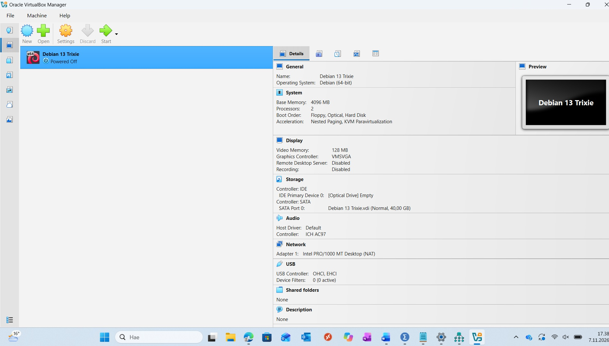

# h3 Cyber Lab

**Cyber Security Studies – Haaga-Helia University of Applied Sciences**  
**Practical work:** 7–9 November 2026

## x) Read and summarize

### Heinonen (2026): How to Install Linux to VirtualBox?

- VirtualBox runs a guest operating system inside a host computer, allowing Linux to be tested without replacing Windows.
- A Debian ISO image can boot a Live environment for testing before installation to a virtual hard disk.
- A virtual machine needs suitable RAM, CPU and disk settings; the actual installation creates a persistent operating system.
- Basic terminal commands help verify the installation.

**My reflection:** I had already worked with VirtualBox and Debian during H2, but initially I was unsure whether I had only used Live mode or completed the installation. Checking the disk layout with `lsblk` made the difference clearer. I appreciate having a separate environment in which I can safely practise unfamiliar tools.

### Karvinen (2020): Command Line Basics Revisited

- Commands such as `pwd`, `ls` and `cd` help navigate the filesystem; `mkdir`, `cp`, `mv` and `rm` manage files and directories.
- Linux has a directory hierarchy, including `/home/`, `/etc/` and `/var/log/`.
- `ssh` supports secure remote access, while `apt-get` installs and manages packages.
- The principle of least privilege means using `sudo` only when elevated permissions are necessary.

**My reflection:** The command line is new to me compared with Windows graphical tools. During this exercise I discovered how much exact spelling matters: confusing `l` with `1`, or `o` with `0`, changes a command. I would like to learn more about examining logs and system configurations in cybersecurity investigations.

### Karvinen (2022): Cracking Passwords with Hashcat

- Password hashes are not plaintext passwords; rather than reversing a hash, a cracking tool tests candidate passwords for a match.
- Hashcat can test a dictionary such as RockYou against a supplied hash.
- Hashid suggests possible hash algorithms; Hashcat's `-m` option selects the mode.
- Testing must be restricted to hashes and systems for which permission has been granted.

**My reflection:** It was surprising that a long-looking hash could correspond to a very common password. This made the risks of weak passwords and fast, unsalted hashing algorithms more concrete. In healthcare, protecting accounts is important for both confidential patient data and continuity of care. A question I have is how organizations can combine secure password storage, strong authentication and usable workflows for busy staff.

## a) Presentation

My course presentation, **“Cybersecurity in Finnish Social and Healthcare Services: Current Threats, Patient Safety and Preparedness,”** took place on 28 October 2026. It addressed trust, patient safety, preparedness and the organizational dimensions of cybersecurity. The presentation and reflection are documented separately in my learning diary.

## b) Linux – Debian 13 Trixie on VirtualBox

### Environment and objective

I reused the Debian virtual machine created during H2 and verified that it was installed on the virtual hard disk, rather than merely running from a Live ISO.

| Component | Configuration |
|---|---|
| Host operating system | Windows 11 |
| Virtualization | Oracle VirtualBox |
| Guest operating system | Debian 13 Trixie (64-bit), Xfce |
| Memory | 4096 MB |
| Processors | 2 |
| Virtual disk | 40 GB |
| Network | NAT |

### Test and result

I started the virtual machine from VirtualBox Manager. Debian booted to the Xfce desktop and the terminal opened normally. I ran:

```bash
lsblk
```

Relevant output:

```text
NAME   SIZE TYPE MOUNTPOINTS
sda     40G disk
├─sda1 31.6G part /
└─sda2  8.4G part [SWAP]
sr0   1024M rom
```

The root filesystem mounted on `sda1` confirmed that Debian was running from the installed virtual disk. The `sda2` partition was used as swap space. No errors occurred during this verification.

**Reflection:** This helped me understand how the operating system, its partitions and the virtual disk relate to one another. The earlier H2 work can be referenced for the original VM setup and screenshots.



*Figure 1. VirtualBox Manager showing the Debian 13 Trixie VM configuration.*

  
- *Figure 2. Debian Xfce desktop after successful boot.*

  
- *Figure 3. Terminal output of `lsblk` showing the mounted root filesystem.*

## c) Crack – Hashcat exercise

### Objective and scope

I followed Karvinen's (2022) example to install the required tools and perform a dictionary attack on the **course-provided practice hash**. All testing took place in my own Debian virtual machine.

### 1. Install the tools

First, I updated the package lists:

```bash
sudo apt-get update
```

The command finished with `Reading package lists... Done`. I then installed the tools:

```bash
sudo apt-get -y install hashid hashcat wget
```

The output included `Setting up hashcat (6.2.6+ds2-1) ...`, and the terminal returned to the prompt without visible errors.

### 2. Create a working directory

```bash
mkdir hashed
cd hashed
```

I initially typed `ch hashed`, which returned `bash: ch: command not found`. Correcting it to `cd hashed` moved me into `~/hashed`.

### 3. Download and verify RockYou

I first used the download command from the article:

```bash
wget https://github.com/danielmiessler/SecLists/raw/master/Passwords/Leaked-Databases/rockyou.txt.tar.gz
```

This returned `ERROR 404: Not Found`. I also checked whether the package was available:

```bash
apt-cache show seclists
```

The result was `N: Unable to locate package seclists` and `E: No packages found`. I then downloaded the text file from an alternative source:

```bash
wget https://github.com/brannondorsey/naive-hashcat/releases/download/data/rockyou.txt
```

This succeeded with `200 OK` and saved `rockyou.txt` (139,921,497 bytes). Because it was already a `.txt` file, no archive extraction was needed.

I verified its line count:

```bash
wc -l rockyou.txt
```

Output:

```text
14344391 rockyou.txt
```

Initially, I mistyped the command by confusing lowercase `l` and digit `1`, and once typed `w` instead of `wc`. After correcting it, the result matched the 14,344,391 lines reported in the article.

### 4. Identify the hash type

I analyzed the supplied hash:

```bash
hashid -m 6b1628b016dff46e6fa35684be6acc96
```

The output included:

```text
[+] MD2
[+] MD5 [Hashcat Mode: 0]
[+] MD4 [Hashcat Mode: 900]
```

Hashid listed several possibilities, so the format alone did not prove the algorithm. Following the course example, I selected MD5 (mode `0`).

### 5. Run Hashcat

The successful command was:

```bash
hashcat -m 0 '6b1628b016dff46e6fa35684be6acc96' rockyou.txt -o solved
```

I had several syntax errors before it ran correctly, including a mistyped program name and confusing the output option `-o` (letter o) with `-0` (digit zero). I also had difficulty pasting from Windows into the Debian VM, so I used the terminal's command history and corrected the command manually.

Hashcat 6.2.6 started using the CPU through OpenCL/PoCL. It warned that *pure (unoptimized) backend kernels* were selected, which reduces performance but did not prevent the exercise.

Relevant final output:

```text
Session..........: hashcat
Status...........: Cracked
Hash.Mode........: 0 (MD5)
Hash.Target......: 6b1628b016dff46e6fa35684be6acc96
Recovered........: 1/1 (100.00%) Digests
Progress.........: 512/14344384 (0.00%)
Started..........: Mon Nov 9 17:10:51 2026
Stopped..........: Mon Nov 9 17:11:57 2026
```

The session took approximately 66 seconds including setup. The status was **Cracked**; the reported progress was 512 candidates out of a keyspace of 14,344,384 when the match was found.

### 6. Verify the saved result

I ran:

```bash
cat solved
```

Output:

```text
6b1628b016dff46e6fa35684be6acc96:summer
```

**Result:** The example MD5 hash was successfully cracked. The recovered practice password was `summer`.

### 7. Problems and solutions

| Problem | Solution |
|---|---|
| `ch hashed` was not a valid command | Used `cd hashed` |
| Original RockYou URL returned HTTP 404 | Used an alternative download URL |
| `seclists` was unavailable in the configured Debian repositories | Downloaded RockYou directly |
| Mistyped `wc -l` | Corrected the letters and option |
| Hashcat command contained typing errors | Corrected `hashcat`, spaces and `-o` option |
| Windows-to-VM clipboard did not paste | Edited a previous command from terminal history |
| Hashcat reported unoptimized kernels | Allowed the CPU-based run to finish |

### Reflection

The most valuable part of this exercise was not only cracking the practice hash but also troubleshooting the environment. An outdated download link and several small typing errors meant that I had to inspect the output, identify what had failed and try again.

I was surprised that the hash was recovered after only 512 candidate attempts. The result illustrates why a common password is weak, especially when stored with a fast, unsalted algorithm such as MD5. Modern password storage should instead use an appropriately configured password-hashing scheme, such as Argon2id, with a unique salt. Multifactor authentication adds another important layer of protection.

For healthcare organizations, this connects technical password security to wider questions of trust, access management and patient safety. I also feel more confident working in a Linux terminal than at the start of the course.

**Screenshot placeholders:**

- *Figure 4. Successful `apt-get update` and Hashcat installation.*
- *Figure 5. Failed original RockYou download (HTTP 404).*
- *Figure 6. Successful alternative RockYou download and `wc -l` output.*
- *Figure 7. Hashid identifying MD5 as Hashcat mode 0.*
- *Figure 8. Hashcat output showing `Status: Cracked`.*
- *Figure 9. `cat solved` confirming the recovered practice password.*

## References

Heinonen, J. (2026). *How to Install Linux to VirtualBox?* https://github.com/johannaheinonen/johanna-test-repo/blob/main/module_1.md

Karvinen, T. (2020). *Command Line Basics Revisited*. https://terokarvinen.com/2020/command-line-basics-revisited/

Karvinen, T. (2022). *Cracking Passwords with Hashcat*. https://terokarvinen.com/2022/cracking-passwords-with-hashcat/

Karvinen, T. (2026). *Cyber Security – h3 Cyber Lab*. https://terokarvinen.com/cyber-security/#h3-cyber-lab
