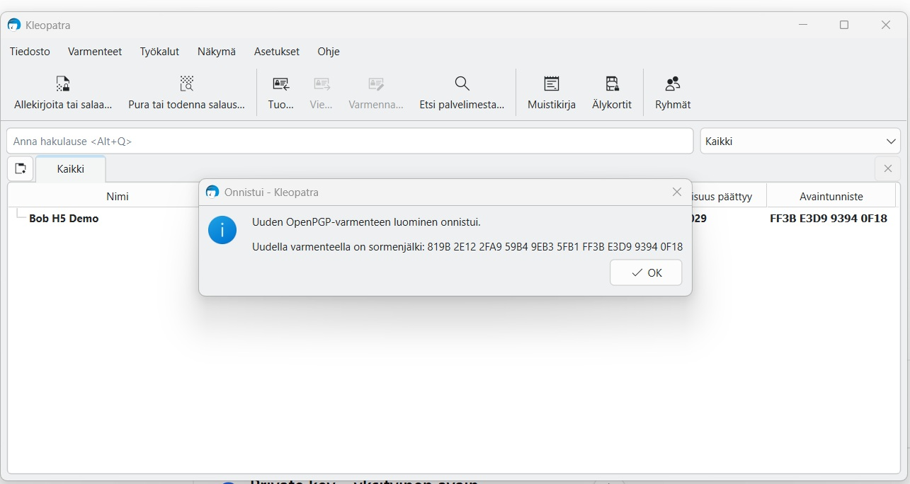
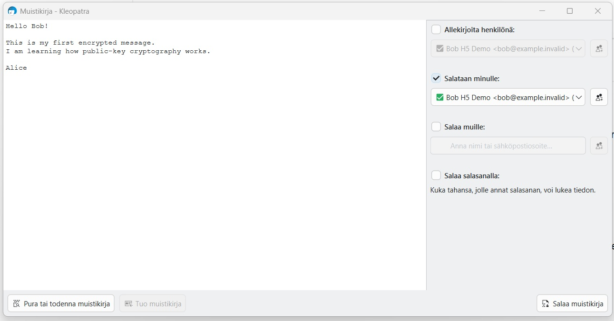
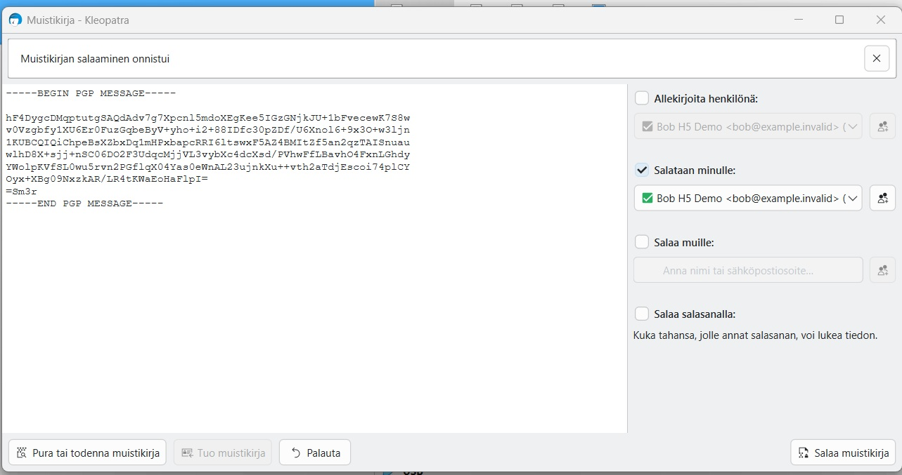
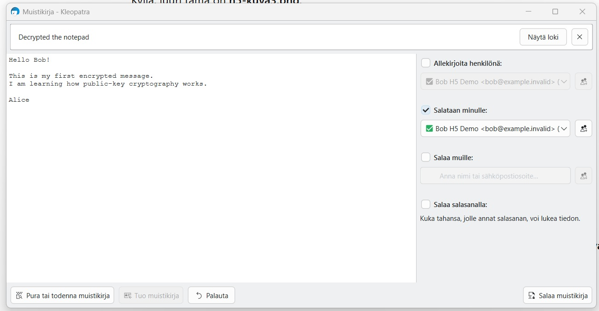

# H5 – Alice and Bob

24 November 2026

## x) Read and summarize

### Schneier (2015): Applied Cryptography – 1.1 Terminology

- Encryption transforms plaintext into ciphertext, while decryption restores the original information.
- In addition to confidentiality, cryptography supports authentication, integrity and nonrepudiation.
- A cryptographic algorithm is a mathematical function used for encryption and decryption.
- Cryptographic security should not depend on keeping the algorithm secret. Publicly available algorithms can be independently evaluated.
- Symmetric encryption typically uses the same secret key for encryption and decryption.
- Asymmetric encryption uses two mathematically related keys: a public key and a private key.
- Symmetric algorithms include stream ciphers and block ciphers.

### Schneier (2015): Applied Cryptography – 2.5 Communications Using Public-Key Cryptography

- Public-key cryptography addresses the key distribution problem associated with symmetric cryptography.
- Trapdoor one-way functions make reversing encryption computationally difficult without the private key.
- Symmetric and asymmetric cryptography are often combined in hybrid cryptosystems.
- Symmetric encryption is computationally more efficient and suitable for protecting message traffic.
- Public-key cryptography can be used to securely establish or distribute session keys.
- Temporary session keys reduce risks associated with the long-term storage of shared secret keys.
- Merkle's Puzzles represent an early approach to establishing a shared secret over an insecure communication channel.

### Karvinen (2023): PGP – Send Encrypted and Signed Message – gpg

- GPG is a tool for encrypting, decrypting and digitally signing messages.
- Public keys can be exchanged over untrusted communication channels, but their authenticity must be verified.
- Key fingerprints can be compared through a trusted communication channel.
- The sender encrypts a message using the recipient's public key.
- The recipient decrypts the message using their own private key.
- Digital signatures are created using the sender's private key and verified using the sender's public key.
- Encryption protects confidentiality, while digital signatures support authentication and integrity.
- PGP signatures can also be used to verify software downloads.

## a) Pubkey today

I used online banking, which is an everyday example of public-key cryptography through HTTPS and the Transport Layer Security (TLS) protocol.

In a typical certificate-based TLS 1.3 connection:

- The server provides a digital certificate containing its public key.
- The server uses its private key to digitally sign handshake data.
- My browser verifies the certificate and the digital signature to authenticate the server.
- The browser and the server use temporary public and private keys to establish a shared secret.
- Symmetric encryption keys are derived from this shared secret and used to protect the actual data transmission.

I did not technically inspect the TLS version or algorithms used during my online banking session.

### Personal reflection

Before studying cryptography, I had not considered how many cryptographic processes take place when I use everyday digital services. I now understand why symmetric and asymmetric cryptography are combined and why verifying the authenticity of public keys is essential for establishing trust.

## b) Encrypt and decrypt a message

I initially tried to use Debian in VirtualBox but encountered graphics driver errors. Therefore, I downloaded and installed Gpg4win (version 5.1.2) and used Kleopatra on Windows 11.

I generated an OpenPGP key pair for a fictional user, Bob H5 Demo, and examined the fingerprint.

*Figure 1. Successful generation of Bob's OpenPGP key pair and its fingerprint.*

I wrote a plaintext message in Kleopatra's Notepad and selected Bob's key for encryption.

*Figure 2. Plaintext message and encryption settings before encryption.*

The message was encrypted using Bob's public key. OpenPGP uses hybrid encryption, combining symmetric encryption of the message with public-key cryptography to protect the session key.

*Figure 3. Successful encryption of the message using Bob's public key.*

Finally, I decrypted the message using Bob's private key. The original plaintext was successfully restored.

*Figure 4. Successful decryption of the message using Bob's private key.*

I simulated the sender and receiver on the same computer using one key pair. I did not digitally sign the message.

### Security evaluation

Gpg4win is open-source software based on GnuPG and supports the OpenPGP standard. Its source code is publicly available for independent review.

However, security also depends on protecting private keys, verifying public key authenticity and keeping the software updated. Successful encryption and decryption alone do not demonstrate the overall security of the software.

### Personal reflection

This practical exercise helped me understand the different purposes of public and private keys. Seeing the original message transformed into ciphertext and then restored made the theoretical concepts easier to understand.

## c) Password management

I used KeePassXC on Windows 11 and installed KeePassium on my iPhone. I stored the encrypted KDBX database in my personal OneDrive to synchronize passwords between the two devices.

I generated a test password and successfully tested synchronization in both directions. I also configured Face ID, automatic locking, automatic backups and restricted network access in KeePassium.

Initially, I encountered synchronization issues. KeePassXC appeared to open an older database instead of the synchronized database. I resolved the issue by opening the correct database from OneDrive and confirmed that it was also accessible through the taskbar shortcut.

### Security threats

Password managers help reduce the risks associated with:

- **Credential stuffing:** using leaked credentials to access other services.
- **Dictionary attacks:** guessing passwords using common words and known passwords.
- **Brute-force attacks:** systematically trying possible password combinations.

Password reuse increases the impact of data breaches and makes credential stuffing particularly effective.

Generating strong, random and unique passwords reduces these risks. However, the master password must also be protected.

### Personal reflection

This exercise was particularly useful because I improved my personal password management while learning about encryption.

I learned that security, usability and availability must be considered together. Synchronization alone is not a substitute for backups.

I did not test the restoration of a separate database backup.

## References

- Schneier, B. (2015). *Applied Cryptography: Protocols, Algorithms, and Source Code in C*. [Section 1.1 – Terminology](https://learning.oreilly.com/library/view/applied-cryptography-protocols/9781119096726/08_chap01.html#chap01-sec001).
- Schneier, B. (2015). *Applied Cryptography: Protocols, Algorithms, and Source Code in C*. [Section 2.5 – Communications Using Public-Key Cryptography](https://learning.oreilly.com/library/view/applied-cryptography-protocols/9781119096726/10_chap02.html#chap02-sec005).
- Karvinen, T. (2023). [PGP – Send Encrypted and Signed Message – gpg](https://terokarvinen.com/2023/pgp-encrypt-sign-verify/).
- Rescorla, E. (2018). [The Transport Layer Security (TLS) Protocol Version 1.3. RFC 8446](https://datatracker.ietf.org/doc/html/rfc8446).
- [Gpg4win](https://gpg4win.org/).
- [GnuPG](https://gnupg.org/).
- [KeePassXC](https://keepassxc.org/).
- [KeePassium](https://keepassium.com/).
